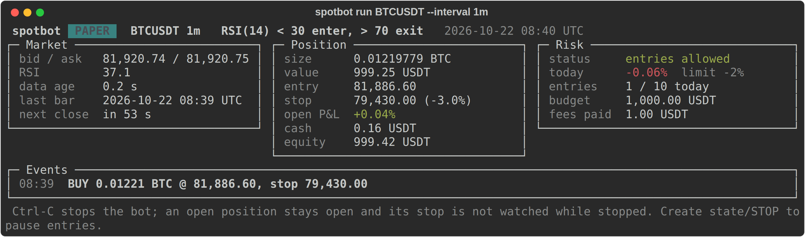
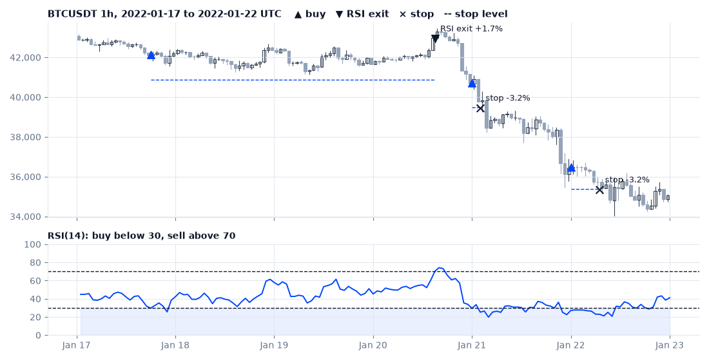
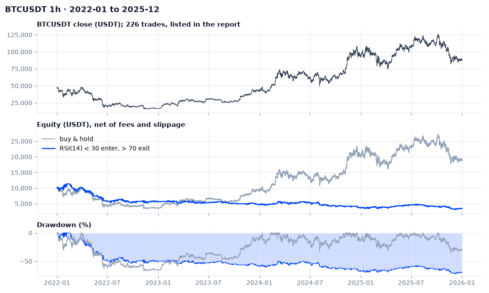

# binance-spot-bot

A Binance spot trading bot meant to be run carefully. It backtests on Binance's public
kline archive, paper-trades on live prices without any API key, and sends real orders
only after checking the key's permissions and asking you to type a confirmation.



It trades one symbol, long only, with a simple RSI rule. The rule is not the interesting
part (the backtest below shows it losing money). The execution code is: a SQLite ledger
that survives restarts, orders with an unknown outcome looked up on the exchange instead
of sent again, risk limits that block new entries but never an exit, and a signing
secret that never leaves the process.

**Status:** backtest and paper mode are the tested, supported paths. Testnet and live
order handling is covered by tests against an in-process fake exchange, but has not yet
been run against Binance's real Spot Testnet. Treat live mode as experimental.

> Not financial advice. This is a personal project; if you run it with real money, you
> can lose that money, and that is on you.

## Quick start

Python 3.11 or newer.

```bash
git clone https://github.com/Jayyo/binance-spot-bot.git
cd binance-spot-bot
python -m venv .venv && . .venv/bin/activate
pip install -e .

spotbot backtest BTCUSDT --start 2024-01 --end 2024-12   # ~0.6 MB of public data
spotbot run BTCUSDT --interval 1m                        # paper trading, no key needed
```

The backtest prints a summary and writes `reports/BTCUSDT-1h-2024-01-2024-12/report.html`
with the chart, the metrics next to buy & hold, every trade, and the SHA-256 of each input
file.

## What the bot does

On every closed bar (1 hour by default):

1. update RSI(14), Wilder's version;
2. if flat and RSI is below 30, buy with the bot's equity (capped by `--max-position`);
3. if holding and RSI is above 70, sell.

Between bars it watches the bid and sells if it falls 3% below the entry fill. New entries
pause for the rest of the UTC day once the bot is 2% below its value at 00:00 UTC; exits
and stops keep working. There are at most 10 entries per UTC day and none in the bar of an
exit.



The RSI levels, the 3% stop and the 2% daily limit come from an earlier bot of mine for
Korean stocks, and I kept them rather than tune them on this data. `--trend-ema 200` adds
one filter: only buy while the close is above its 200-bar EMA.

## Results on public data

Hourly bars from January 2022 to December 2025, 10,000 USDT, a 0.10% fee and 0.05%
slippage on every fill (buy & hold pays the same). The setup was fixed before the first
run and nothing was tuned on it.

| Symbol | Rules | Return | Before costs | Max drawdown | Trades | Bars in market | Buy & hold | B&H max drawdown |
|---|---|---:|---:|---:|---:|---:|---:|---:|
| BTCUSDT | RSI | -65.4% | -34.1% | -72.1% | 226 | 37% | +89.1% | -67.4% |
| BTCUSDT | RSI + EMA200 | -21.9% | -15.1% | -23.1% | 31 | 5% | +89.1% | -67.4% |
| ETHUSDT | RSI | -75.7% | -52.0% | -77.3% | 265 | 33% | -19.4% | -76.7% |
| ETHUSDT | RSI + EMA200 | +2.3% | +11.3% | -22.1% | 31 | 4% | -19.4% | -76.7% |
| SOLUSDT | RSI | -82.0% | -61.7% | -85.5% | 277 | 26% | -26.9% | -95.4% |
| SOLUSDT | RSI + EMA200 | -3.4% | +2.1% | -21.6% | 21 | 2% | -26.9% | -95.4% |



Plain RSI dip buying loses on all three coins even before costs, and 226 to 277 round
trips at about 0.3% each make every run worse ("before costs" reruns the same rules with
no fee or slippage, so its trades are not exactly the same ones). The 3% stop gets hit
over and over in sell-offs, which is the pattern in the six-day chart above. With the
EMA200 filter the bot trades about 30 times in four years and holds a position in 2 to
5% of the bars; its smaller drawdowns mostly reflect how rarely it is invested. Three
large coins over one four-year window is a convenience sample, not evidence about
crypto in general.

To reproduce: `python scripts/readme_results.py`. It downloads about 6 MB from Binance's
public archive (the data is not stored in this repository) and stops if any file differs
from the SHA-256 values pinned in [`docs/results/manifest.json`](docs/results/manifest.json).
Exact conditions and yearly numbers are in [`docs/results/results.md`](docs/results/results.md).

## Paper, testnet, live

```bash
spotbot run BTCUSDT --interval 1m                          # paper: live prices, simulated fills
spotbot run BTCUSDT --testnet                              # orders on the Spot Testnet (fake funds)
spotbot run BTCUSDT --live --budget 200 --max-position 50  # real orders, after checks and a typed confirmation
```

Paper mode fills at the current bid/ask with a 0.10% fee and applies the symbol's real
lot-size and minimum-order rules. Its ledger lives in `state/paper-BTCUSDT.db`, so a
restart continues where it stopped.

Testnet and live need an API key; [docs/api-keys.md](docs/api-keys.md) covers creating a
trade-only, IP-restricted one and what the bot does with it. `spotbot check-key --live`
reports what the bot thinks of your key and account without placing anything.

While it runs, creating `state/STOP` pauses entries (stops and exits keep running) and
deleting it resumes them. Ctrl-C stops the process; an open position stays open, and its
stop is not watched until the bot runs again. `spotbot status BTCUSDT` prints the ledger,
any unresolved order and recent events without touching the network.

## Safety rails

| Rule | Where |
|---|---|
| Paper and backtest never load credentials | `runner.build_clients` |
| Testnet and live read different variables, so one can't use the other's key | `keys.py` |
| Live refuses keys with withdrawal, internal or universal transfer, margin-loan, futures, options or portfolio-margin permission, keys without an IP whitelist, and keys whose permissions Binance doesn't report | `runner.key_checks` |
| Live needs explicit `--budget` and `--max-position`, then `LIVE <SYMBOL>` typed in a terminal | `cli.py`, `runner.confirm_live` |
| An order with an unknown outcome is never resent; the bot asks the exchange until it knows, and sends nothing else meanwhile | `engine.reconcile` |
| Risk limits block entries, never an exit; once an exit is decided it is retried until the bot is flat | `risk.py`, `engine._check_exits` |
| Sell orders are capped at the quantity attributed to the bot's own recorded fills | `engine._exit` |
| A position worth less than the exchange's minimum order keeps its stop; leftovers under the minimum lot size count as dust | `engine._exit` |
| If the bot was down at 00:00 UTC, or a fill from before midnight turns up late, the daily-loss baseline is rebuilt from the ledger and the 00:00 price; if it can't be, entries stay paused | `engine._roll_day` |
| Each ledger (`state/<mode>-<symbol>.db`) belongs to one account, symbol and budget; strategy and risk settings can change only while flat | `engine._bind_state` |
| One bot per state directory and mode | `runner.StateLock` |

## How it's built

```
 Binance public data ──► runner.py (paper/testnet/live)   or   backtest.py (archive replay)
                                     │ ticks and closed bars
                                     ▼
          strategy.py ──signal──► engine.py ──orders──► venues.py ──► binance.py (signed REST)
                                  │      │                  └──► SimVenue (paper, backtest)
                         risk.py ─┘      └─► ledger.py (SQLite: intents, fills, state, events)
```

The engine is the same object in every mode. The backtest drives it with historical bars
(decide at a bar's close, fill at the next open, check the stop against each bar's low);
paper, testnet and live drive it with polled prices and closed klines. A separate, plain
reimplementation of the rules in `tests/reference.py` must produce the same equity curve.

- `ledger.py` writes each order intent before it is sent and each fill by trade id.
  Cash, quantity and fees are recomputed from fills, whether commission was paid in the
  base asset, the quote asset or BNB.
- `binance.py` is a small client over `requests`, written from the official API docs:
  HMAC, Ed25519 and RSA signing, clock offset, 429/418 back-off, and a three-way split
  between rejected, unknown outcome and never sent.
- `data.py` downloads monthly archives from data.binance.vision, checks the SHA-256 that
  Binance publishes next to each file, reads both the old millisecond and the 2025+
  microsecond timestamps, and reports missing bars instead of filling them.

One process, standard-library SQLite, no Docker or database server. Runtime dependencies
are requests, rich, matplotlib, cryptography and python-dotenv.

## Tests

```bash
pip install -e ".[dev]"
pytest
```

About 190 tests run in a few seconds without network access. The ones I care most about:

- the engine and the reference implementation agree to 1e-9 on random price paths, and
  changing future bars never changes earlier fills;
- RSI matches Wilder's published example, HMAC signing matches Binance's documented
  request byte for byte, Ed25519 matches RFC 8032;
- a fake exchange inside the test process (signature and timestamp checks, lot size,
  minimum order value, balances) runs the real runner and HTTP client through a round
  trip, a lost order response and a restart;
- engine failure cases: outcome unknown then filled, order never seen, partial fills,
  exits the exchange rejects, a position under the minimum order value, coins moved out
  of the account, a fill from before midnight recorded late, trade ids reused after a
  testnet reset, the STOP file while price requests fail.

## Limitations

- One symbol, long only, market orders. There is no exchange-side stop, so nothing
  protects an open position while the process or the network is down.
- Stops are checked on each poll (every 5 seconds by default) against the bid, so a fast
  move can fill well below the stop. The backtest assumes a stop fills at the stop price
  unless a bar opens below it.
- The backtest ignores order book depth and exchange filters; costs are a flat fee plus
  slippage.
- Deposits and withdrawals are not tracked. The budget is fixed when a ledger is
  created.
- Fees paid in BNB are valued at the BNB ticker price when the fill is recorded; if that
  price is unavailable they are shown as unvalued and left out of equity.
- Binance's main site is not available in every country; the public data archive and
  the Spot Testnet are separate services.

## Background

This replaces two private projects: a multi-service Binance bot (Postgres, Grafana, five
strategies) and an RSI bot for Korean stocks over Kiwoom Securities' REST API. It keeps
the RSI rules and the paper-broker idea from the second and the Binance target from the
first, in one small process with the safety checks up front.

## 한국어 요약

바이낸스 현물 자동매매 봇입니다. 공개 데이터로 백테스트하고, API 키 없이 실시간 시세로 모의매매하며,
실거래는 키 권한 점검(출금 권한 금지, IP 제한 필수)과 직접 입력 확인을 통과해야만 시작합니다.
기본 전략(RSI 30/70)은 위 백테스트에서 손실이 났습니다. 이 저장소의 중심은 전략이 아니라 주문 처리와
안전장치입니다. 투자 조언이 아니며, 실거래 손실은 실행한 사람의 책임입니다.

## License

MIT, see [LICENSE](LICENSE).
